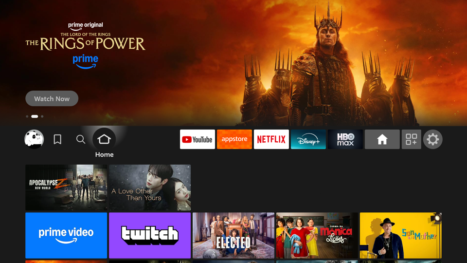
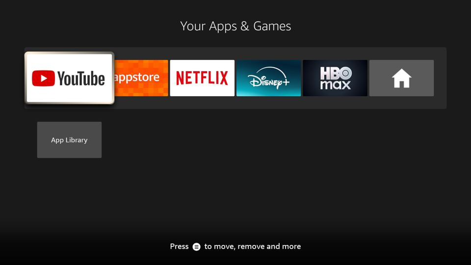

# Minimal Fire Stick

Turn a Fire TV Stick into a clean, minimal TV box. Press **Home** and you get **Your Apps & Games**, just your apps on a dark grid, instead of Amazon's home screen full of ads, trailers and recommendations. No root needed.

| Before: Amazon's home | After: press Home |
|:---:|:---:|
|  |  |

- **Home always opens your apps.** This works from any app, from Settings, and even from Amazon's own home screen.
- **It starts there too.** After a reboot, and when the stick wakes up from sleep, you land on your apps.
- **Amazon's home is still there when you need it.** An **Amazon Home** tile in the grid opens it, for search, profiles and so on. It stays until you press Home or open an app.
- **Settings work as usual.** Back from a settings screen stays in Settings.
- **Optional debloat.** A script turns off Amazon background apps (telemetry, ads, tutorials, extra Alexa features), and another one turns them back on.
- **No internet permission and no data collection.** The app only watches which window is in front.

The app shows in Portuguese on devices set to Portuguese and in English everywhere else.

## How it works

Fire OS does not let third-party apps replace the launcher or catch the Home key. This app runs an accessibility service instead. It reacts to three signals:

- Amazon's home window coming to the front.
- The `com.amazon.tv.launcher.HOME_PRESSED` broadcast that Amazon's launcher sends for every Home press, even when its home is already on screen. This idea comes from [FireFrame](https://github.com/dyascj/FireFrame).
- Right after boot, Amazon's home being up.

Then the service:

1. Covers the screen with a dark overlay that matches the grid's background, so Amazon's home does not flash.
2. Clicks the launcher's own "all apps" button. The grid opens right away this way. Starting it directly would hit the delay of about 5 seconds that Fire OS puts on app starts right after Home.
3. Removes the overlay once the grid has drawn. If the button never shows up, it starts the grid directly instead.

The cover never stays on for more than 4 seconds. If something goes wrong, you just see Amazon's home.

## Compatibility

Tested on a **Fire TV Stick Lite with Fire OS 7** (Android 9). The service finds the "all apps" button by its view ID in Amazon's launcher (`nav_bar_app_overflow`). Other models or Fire OS versions may use different IDs. Fire OS 8 has not been tested. Pull requests are welcome.

## Install

You need a computer with `adb` ([Android platform-tools](https://developer.android.com/tools/releases/platform-tools)). To build the app you also need JDK 17 and the Android SDK.

1. **Turn on ADB debugging on the Fire TV.** Go to Settings › My Fire TV › Developer options › ADB debugging. If Developer options is missing, open Settings › My Fire TV › About and click the device name 7 times. The IP address is under Settings › My Fire TV › About › Network.
2. **Build the app.**
   ```sh
   ./gradlew assembleRelease
   ```
   The release build is signed with the Android debug key, so you don't need to set up a keystore.
3. **Install it and turn the service on.**
   ```sh
   scripts/install.sh <fire-tv-ip>
   ```
   The first time, accept the "Allow USB debugging?" prompt on the TV.
4. **Press Home on the remote.**

To undo everything, run `adb uninstall local.inicio`.

## Optional: debloat

```sh
scripts/debloat.sh <fire-tv-ip>    # disable
scripts/restore.sh <fire-tv-ip>    # turn everything back on
```

The debloat script disables the 36 Amazon background apps listed in [`scripts/debloat-packages.txt`](scripts/debloat-packages.txt). They cover telemetry, ad ID, tutorials, extra Alexa features, the Live TV tab, Prime Video and more. The script uses `pm disable-user`, so nothing is uninstalled and a factory reset also brings everything back. Read the list first and delete any line you want to keep. For example, keep `com.amazon.firebat` if you watch Prime Video, and `com.amazon.tv.livetv` if you use Live TV.

## Known issues

- **Prime Video is not in the grid.** Amazon leaves Prime Video out of "Your Apps & Games" even when it is installed and only links to it from its own home screen. Use the **Amazon Home** tile to reach it.
- **Profiles.** Fire OS 7 does not ask "Who's watching?" by itself. To switch profiles, use the **Amazon Home** tile and pick the avatar.
- **Tile name after a language change.** The grid keeps the tile name from install time. Reinstall the app to update it.

## Related projects

- [FireFrame](https://github.com/dyascj/FireFrame) replaces Amazon's home with its own home screen: a wallpaper, a clock and a dock of your apps. Pick it if you want a designed home screen. Pick this project if you want the smallest change, built on Amazon's own apps grid.

## Disclaimer

This is an independent project. It is not affiliated with or endorsed by Amazon. Fire TV is a trademark of Amazon.com, Inc. Use it at your own risk.

## License

[MIT](LICENSE)
